<p align="center">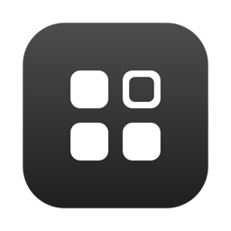</p>

# macOS Personal Toolset

A personal set of small macOS tools in one menu bar app, **Toolset**. It replaces six separate apps with one process, one Accessibility permission, and one login item.

A feature that is off is never started, so it costs no CPU, no observers, and no timers.

| Feature | What it does | Replaces |
|---------|--------------|----------|
| [HiDPI](#hidpi) | Sharp text on external displays, with the HiDPI sizes that macOS hides | BetterDisplay |
| [Window Switcher](#window-switcher) | ⌥ Tab switches between the windows of the frontmost app, on all Spaces | OptionTab |
| [Space Profiles](#space-profiles) | Restores your desktops and windows when you connect or disconnect a display | Dispace |
| [Input Memory](#input-memory) | Keeps the input source (for example ABC or Vietnamese Telex) of each window | Input Source Pro |
| [Mouse Scrolling](#mouse-scrolling) | Smooth scrolling and an inverted direction for a mouse wheel | Mac Mouse Fix (two settings) |
| [Keyboard Lock](#keyboard-lock) | Hold ⌘⇧L to lock the keyboard while you clean it | KeyboardCleanTool |

Fan control (Macs Fan Control) is not in Toolset. It needs a root helper to write the SMC, so it stays a separate app.

## Menu bar

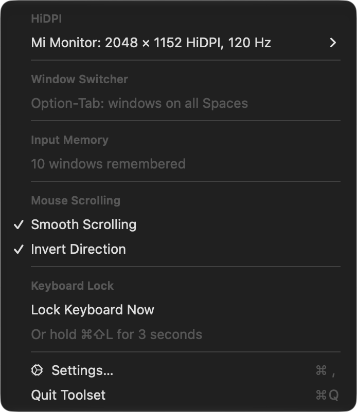

The menu has one section for each feature that is on, with at most three items. All other settings are in the Settings window.

## Features

### HiDPI
Toolset adds the hidden HiDPI modes of an external display and selects your size at launch and each time the display connects.

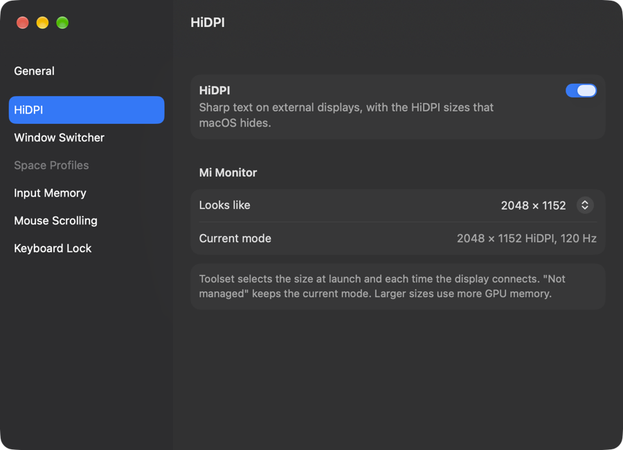

### Window Switcher
⌥ Tab opens a list of the windows of the frontmost app, most recent first. Release ⌥ to focus the selected window. ⌘ Tab still switches apps.

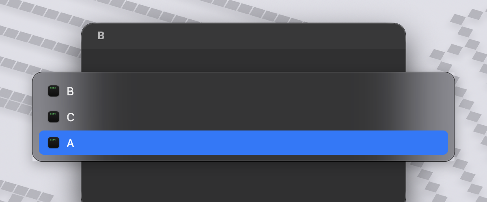

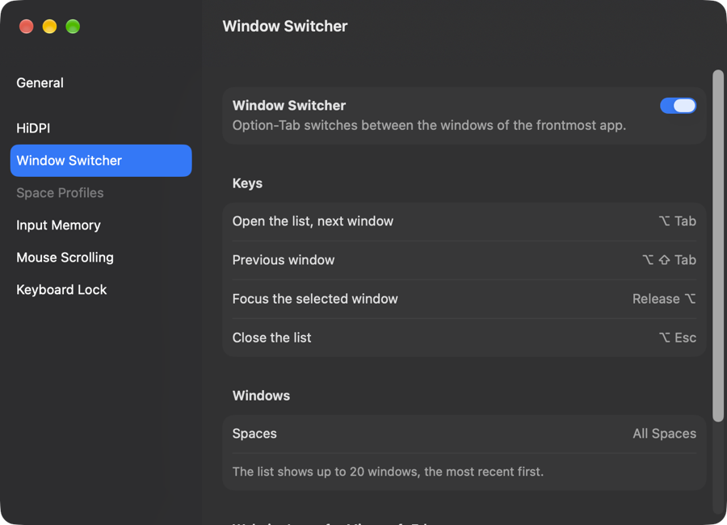

### Space Profiles
Save the desktops and windows for each display setup (built-in display only, or built-in plus external). When the setup changes, Toolset adds or removes desktops and moves each window back to its desktop, position, and size.

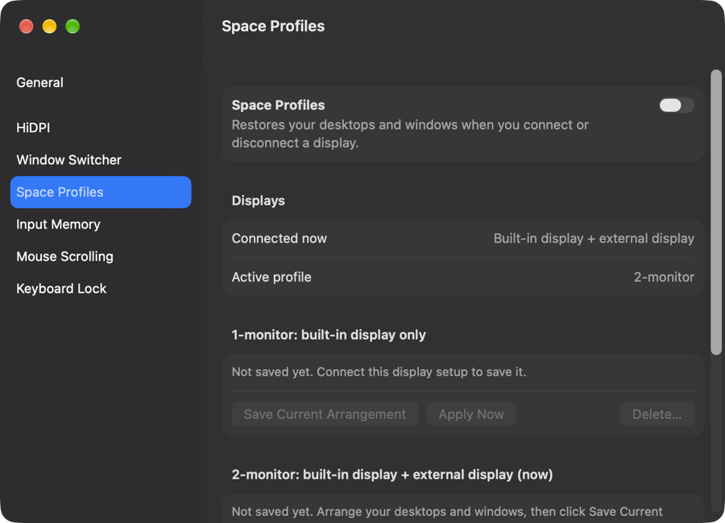

### Input Memory
Each window keeps its own input source. Rules can set the start source for the new windows of an app.

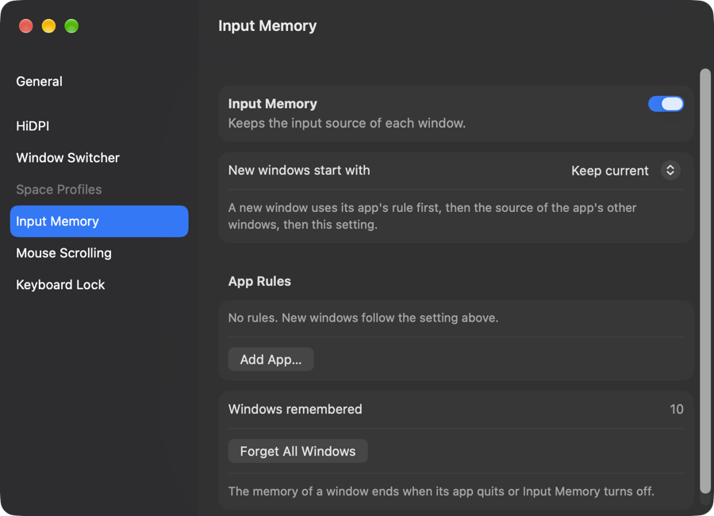

### Mouse Scrolling
A mouse wheel glides instead of jumps, and its direction can be the opposite of the trackpad. The trackpad and the Magic Mouse do not change. The scroll speed in System Settings still applies.

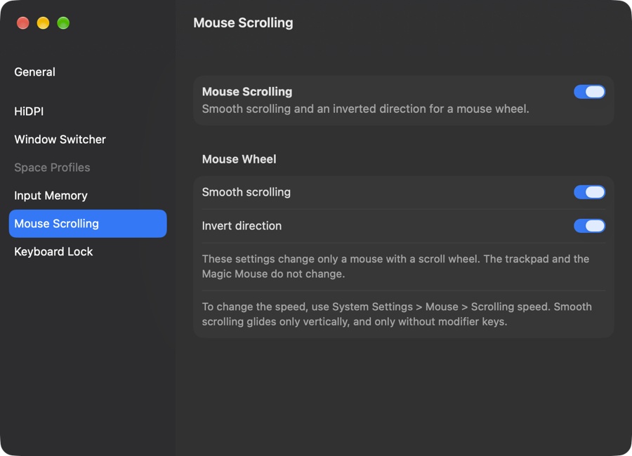

### Keyboard Lock
Hold ⌘⇧L for 3 seconds. A ring shows the progress, and a release before 3 seconds cancels the lock.

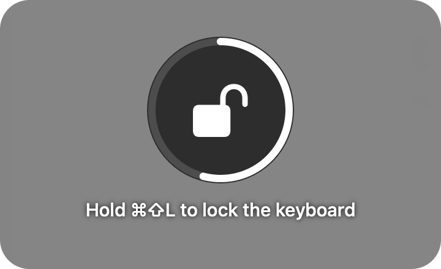

While the keyboard is locked, every display is dark and shows a lock. Click the lock, and the keyboard unlocks after 3 seconds.

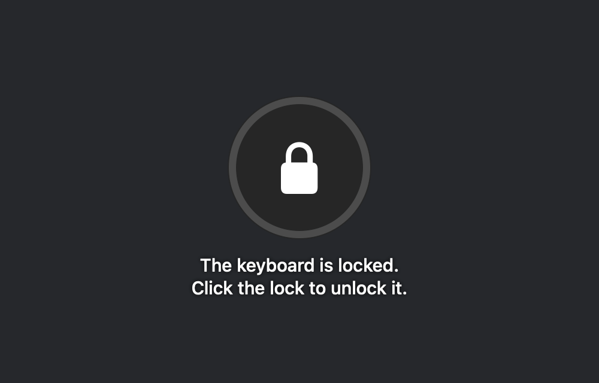

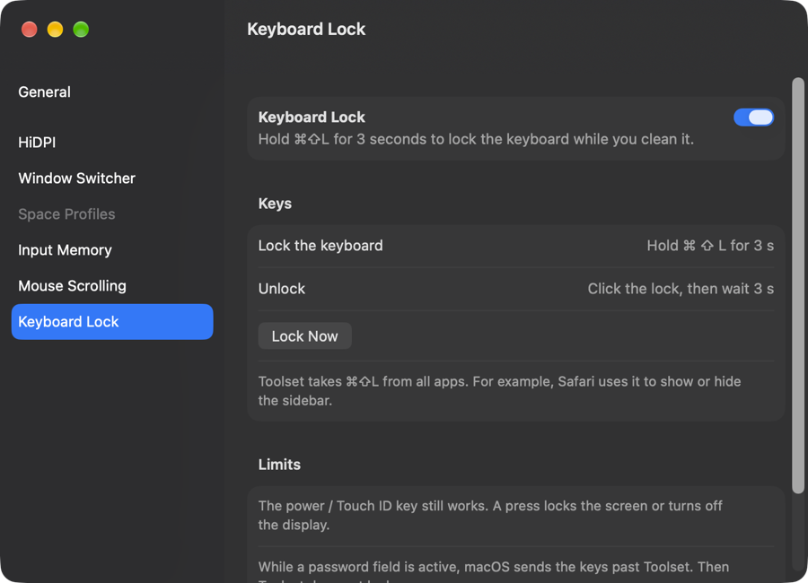

Limits: the power / Touch ID key still works, and Toolset cannot lock while a password field is active (Secure Input). Toolset takes ⌘⇧L from all apps, for example from the Safari sidebar shortcut.

### General

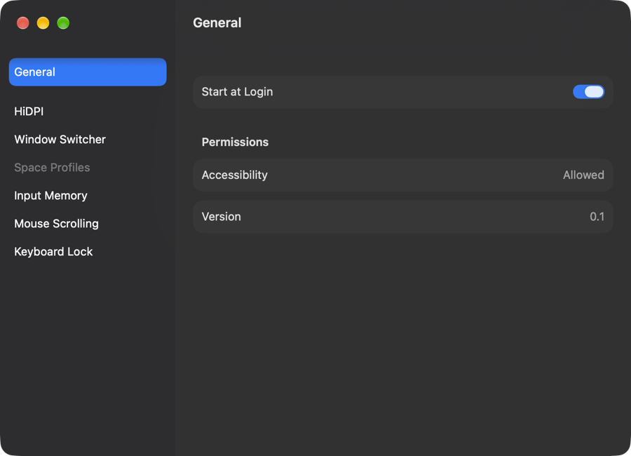

## Requirements
- macOS 14 or later (tested on macOS 27, Apple silicon)
- Xcode or the Swift 6 command line tools
- Optional: an Apple Development signing identity, so the Accessibility permission stays after a rebuild

## Build and install
```bash
./build.sh --install
```
This builds `Toolset.app`, copies it to `/Applications`, and opens it. Then turn on **Toolset** in **System Settings > Privacy & Security > Accessibility**.

- `./build.sh` builds only, into `build/`.
- `./build.sh --run` builds and opens the copy in `build/`.

## Private APIs
Some features use private macOS functions: SkyLight for Spaces and windows (Space Profiles, Window Switcher) and CoreGraphics display modes (HiDPI). A macOS update can remove them. Toolset checks each function at launch and turns off only the part that needs it.

## Project layout
```
Sources/
  ToolsetCore/      shared services: Accessibility helpers, focus tracker, display watcher, login item
  ToolsetApp/       the menu bar app, the Settings window, the feature registry
  HiDPI/  WindowSwitcher/  SpaceProfiles/  InputMemory/  MouseScroll/  KeyboardLock/
Resources/Toolset/  Info.plist and the app icon
Icon/               the script that draws the app icon
docs/               one file for each step of the work
```
Each feature is one library target that conforms to `ToolsetFeature`. A new feature is one new target and one line in the feature list of `AppDelegate`.

## Documentation
The [`docs/`](docs/) folder has one file for each step: the design ([01_toolset_architecture.md](docs/01_toolset_architecture.md)), each feature, and the test results.
